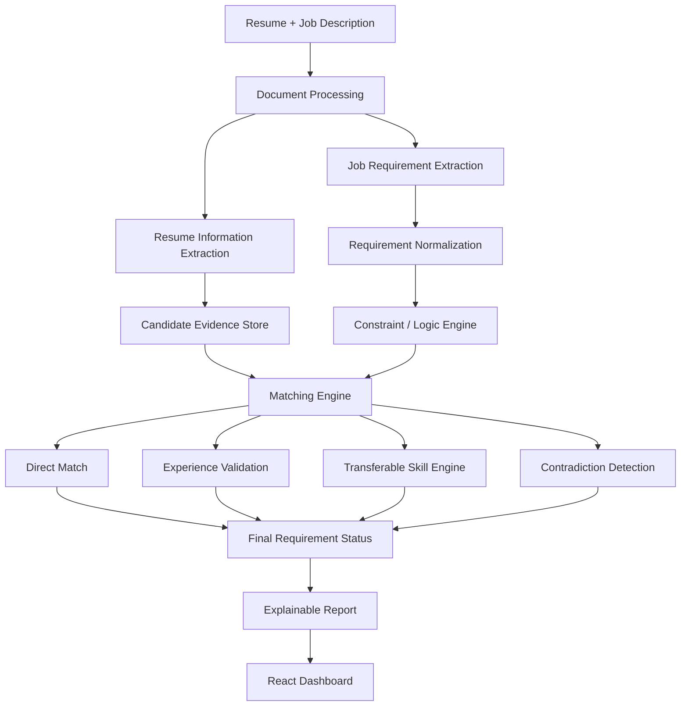
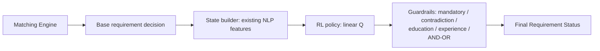

# Architecture — JobFit AI

Constraint-aware, requirement-level candidate–job matching. Primary output is a
per-requirement explainable verdict; the overall score is secondary and gated on
mandatory requirements.

RL decision layer (additive, optional):

`app/nlp/rl/` holds `config.py`, `state_builder.py`, `reward.py`,
`environment.py`, `policy.py`, `trainer.py`, `inference.py`, `evaluate.py`.
The deterministic matcher stays the entry point
(`matcher/engine.py::match_requirement`); `services/analysis.py` applies
`rl/inference.py::decide_requirement` per requirement only when
`RL_ENABLED=true` and a model file exists — otherwise the base decision is
persisted unchanged (fallback). Scoring (`matcher/scoring.py`) consumes the
final status exactly as before, so the mandatory gate is unaffected.

## Layers

- `app/api/v1` — thin HTTP routes (validation, status codes, no NLP logic).
- `app/services` — orchestration (`analysis.py`), storage abstraction.
- `app/nlp` — parsers, extractors, ontology, experience engine, matcher, embeddings, LLM.
- `app/models` / `app/db` — SQLAlchemy 2.x, Alembic, Postgres+pgvector (SQLite fallback for tests).
- `app/workers` — Celery; falls back to inline execution when Redis is down.
- `frontend` — React+Vite+TS dashboard (upload → poll → requirement report → research).

## Async analysis lifecycle

`QUEUED → PROCESSING → COMPLETED | FAILED`, with `progress` and per-stage
`timings` (candidate extraction, requirement extraction, matching, total) persisted
on the `analyses` row. The frontend polls `GET /analyses/{id}`.
